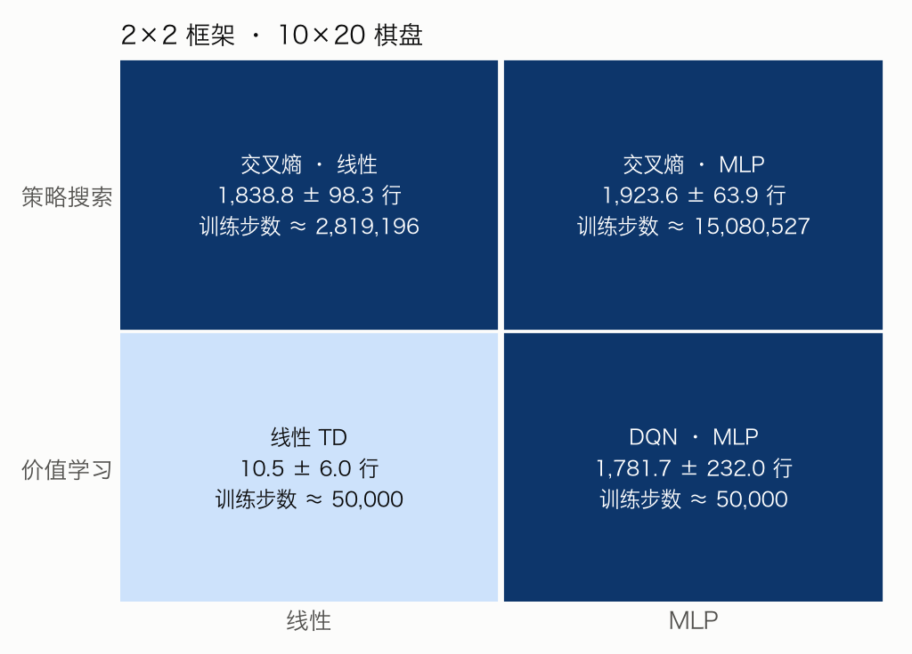
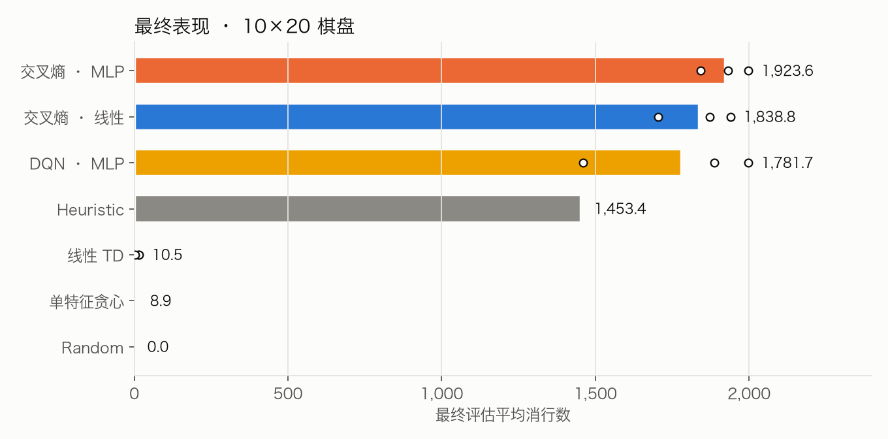
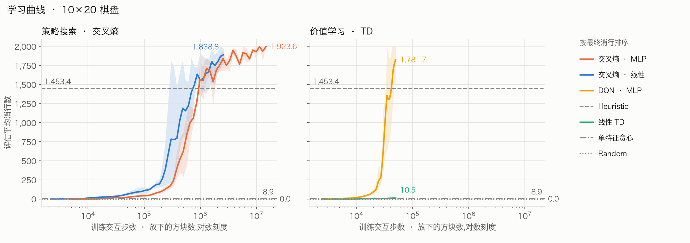
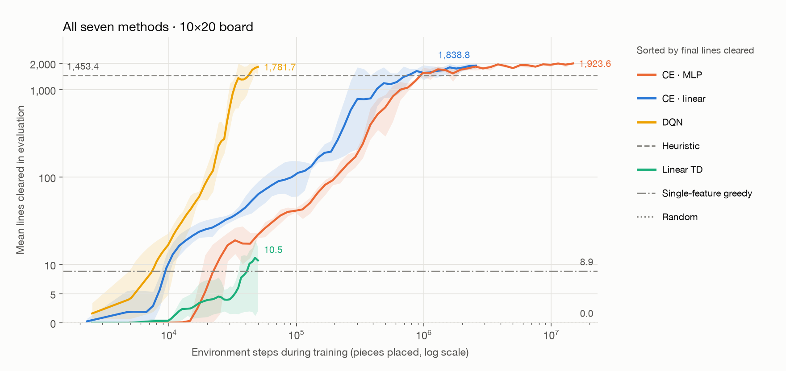

# Policy Search vs. Value Learning in Tetris: A 2×2 Study

A controlled 2×2 experiment on the standard 10×20 Tetris board that compares two **optimization approaches** (policy search vs. value learning) and two **function classes** (linear vs. MLP):

| | Linear | MLP |
|---|---|---|
| **Policy search**: cross-entropy method | CE · linear | CE · MLP |
| **Value learning**: afterstate TD | Linear TD | DQN |

All four models share the same environment, the same features, the same action-selection rule and the same evaluation protocol, and all of them are trained on the **number of lines cleared**. Differences in the results therefore come from these two factors only. Three untrained reference agents are included for comparison: Random, a single-feature greedy agent and a hand-tuned Heuristic.

## Background

### The rules of Tetris

Tetris was designed by Alexey Pajitnov in 1984. It is played on a vertical board 10 cells wide and 20 cells tall:

1. **Pieces**: pieces (tetrominoes) made of four cells appear one at a time. There are seven shapes, usually called I, O, T, S, Z, J and L.
2. **Placement**: the player moves and rotates the current piece and drops it. Once it lands it is fixed to the board and the next piece appears.
3. **Line clears**: when a row is completely filled, it is removed and everything above it moves down by one row. A single placement can clear up to four rows.
4. **Game over**: when the stack reaches the top and a new piece cannot be placed, the game ends.

The goal is to clear as many lines as possible and keep the game going. This project measures a policy by **the total number of lines cleared in a game**, the most common metric in Tetris research (Algorta & Şimşek, 2019).

### Why Tetris is used to study reinforcement learning

- **Huge state space**: a 10×20 board has $2^{200}$ possible fillings, far too many to enumerate, so states or policies must be represented with features and function approximation.
- **Simple rules, clear outcomes**: each decision is only where to put the current piece, and its quality is measured directly by lines cleared.
- **A genuinely hard problem**: even when the whole piece sequence is known in advance, finding the optimal placements is NP-complete (Demaine et al., 2003). When pieces arrive uniformly at random, every game ends with probability one (Burgiel, 1997), so the length of a game measures how good a policy is.
- **A long research record**: from early approximate dynamic programming (Bertsekas & Tsitsiklis, 1996) to policy search with the cross-entropy method (Szita & Lőrincz, 2006; Thiery & Scherrer, 2009) and classification-based policy iteration (Gabillon et al., 2013), Tetris has been a standard benchmark for comparing RL methods. A recurring observation is that methods that search directly in policy space score orders of magnitude higher than methods that learn a value function. This project revisits that observation under controlled conditions.

### Rules used in this project

The project uses the [Tetris-Gymnasium](https://github.com/Max-We/Tetris-Gymnasium) environment with the following settings:

| Aspect | Setting |
|---|---|
| Board | 10 columns × 20 rows |
| Piece generation | The seven pieces are dealt in shuffled groups of seven ("7-bag") |
| Actions | Choose the final placement directly (column × rotation, 40 options); the piece is hard-dropped and no moves during the fall are modelled |
| Gravity | Off, so there is no time pressure |
| Preview and hold | Not used: the agent sees only the current piece, not the next one, and cannot hold a piece |
| Metric | Total lines cleared in a game |

This is the usual "one-piece controller" setting in the literature: each decision depends only on the current piece and the board, with no lookahead at later pieces (Thiery & Scherrer, 2009).

## Key findings

1. **With linear functions, policy search is far stronger than value learning.** CE · linear clears 1,838.8 lines on average, linear TD only 10.5, about 175 times fewer, and this holds for all three seeds. This agrees with Gabillon et al. (2013): in Tetris, value-function methods have long lagged far behind methods that search directly for a policy.
2. **With an MLP, value learning catches up.** DQN reaches 1,781.7 lines, in the same top group as both CE models. All three beat the Heuristic (1,453.4 lines).
3. **The function class matters far more for value learning than for policy search.** Going from linear to MLP takes value learning from 10.5 to 1,781.7 lines, but policy search only from 1,838.8 to 1,923.6.
4. **DQN is much more sample-efficient.** DQN trains for only 50,000 steps and first beats the Heuristic after 35,000–47,500 steps. CE · linear needs 310,000–875,000 steps and CE · MLP 960,000–1,070,000.
5. **All 15 weights of CE · linear are directly interpretable**, and their signs agree across all three seeds; see [Learned weights of CE · linear](#learned-weights-of-ce--linear).

> Most evaluation games of the strong models hit the cap of 5,000 pieces per game (see [Evaluation protocol](#evaluation-protocol)), so the scores of the top three are lower bounds and cannot be used to rank them reliably.

---

## Contents

- [Background](#background)
- [Key findings](#key-findings)
- [Environment and features](#environment-and-features)
- [Methods](#methods)
- [Evaluation protocol](#evaluation-protocol)
- [Pipeline](#pipeline)
- [Results](#results)
- [Discussion](#discussion)
- [Limitations](#limitations)
- [Reproducing the results](#reproducing-the-results)
- [Code layout](#code-layout)
- [References](#references)
- [Third-party code](#third-party-code)

---

## Environment and features

**Afterstate features.** For every candidate placement, the piece is placed in simulation and 13 features are computed from the resulting board (the afterstate):

| Feature | Count | Meaning | Scaling |
|---|---:|---|---|
| Column heights | 10 | Height of the highest filled cell in each column | ÷ 20 |
| Maximum height | 1 | Height of the tallest column | ÷ 20 |
| Holes | 1 | Empty cells with a filled cell somewhere above them | ÷ 40 |
| Bumpiness | 1 | Sum of absolute height differences between adjacent columns | ÷ 40 |

These are a subset of the hand-crafted features commonly used in Tetris research (Bertsekas & Tsitsiklis, 1996; Thiery & Scherrer, 2009).

**Fix to the environment.** The original library encodes placements that end the game with the features of an empty board, which looks like the best possible outcome and misleads every method that scores placements by their features. [`t2x2/env.py`](t2x2/env.py) encodes these placements as a full-height board instead. Two further changes to the library itself are listed under [Third-party code](#third-party-code).

**Reward.** The reward of a step is the number of lines it clears, and 0 when the game ends. This matches the objective of the cross-entropy method (total lines cleared in a game).

## Methods

### Shared action selection

All four models act greedily one step ahead: they score every legal placement and pick the highest-scoring one, with no search over later moves. They differ only in the scoring function and in how its parameters are obtained.

### Policy search: noisy cross-entropy method

The cross-entropy method (Rubinstein, 1999; de Boer et al., 2005) is a gradient-free black-box optimizer. Szita & Lőrincz (2006) found that adding a decreasing amount of extra noise to the variance of the parameter distribution prevents premature convergence, and used it to train a linear Tetris controller that clears about 350,000 lines per game. This project follows that recipe; see [`t2x2/train_ce.py`](t2x2/train_ce.py).

**Scoring function**: the input is the 13 scaled features plus the number of lines the placement clears, 14 values in total.

- Linear: $\text{score} = w^\top x + b$, 15 parameters.
- MLP: 14 → 16 → 1 with ReLU, 257 parameters.

**Training loop** (one generation):

1. Sample $N$ parameter vectors from a diagonal Gaussian $\mathcal{N}(\mu, \sigma^2)$, starting from $\mu = 0$, $\sigma = 1$.
2. Play 3 games with each parameter vector. All samples of a generation use the same 3 game seeds, so they are compared fairly. Each game is capped at 2,000 pieces.
3. Use the mean lines cleared over the 3 games as fitness and keep the best $\rho N$ samples as the elite set $E_t$.
4. Refit the distribution to the elites and add the decreasing extra variance: $\mu_t = \text{mean}(E_t)$, $\sigma_t^2 = \text{var}(E_t) + \max(0.5 - 0.02(t-1),\ 0)$.

After training, the final mean $\mu$ is used as the policy.

| Hyperparameter | CE · linear | CE · MLP |
|---|---:|---:|
| Population $N$ | 50 | 100 |
| Elite fraction $\rho$ | 0.2 | 0.1 |
| Generations | 30 | 50 |
| Games per sample | 3 | 3 |
| Piece cap per training game | 2,000 | 2,000 |

The MLP has about 17 times as many parameters as the linear model and is harder to search, so it gets a larger population and more generations.

### Value learning: afterstate TD learning

Because the board after a piece lands is deterministic, the agent can learn the **value of the afterstate** $V(s')$ instead of a state-action value (Sutton & Barto, 2018, §6.8). Actions are chosen by

$$a^* = \arg\max_a \big[\, r(a) + \gamma\, V(s'_a) \,\big]$$

where $r(a)$ is the number of lines placement $a$ clears immediately and $s'_a$ is the resulting board. Placements that end the game have $V = 0$.

**Training target** (one-step TD; Sutton, 1988): for the afterstate $s'_t$ actually chosen,

$$V(s'_t) \leftarrow r_{t+1} + \gamma \max_a \big[\, r(a) + \gamma\, V_{\text{target}}(s'_{t+1,a}) \,\big]$$

Training uses the standard DQN components (Mnih et al., 2015): experience replay, a periodically synchronized target network, the Huber (smooth L1) loss and ε-greedy exploration, with the Adam optimizer (Kingma & Ba, 2015). See [`t2x2/train_td.py`](t2x2/train_td.py).

- Linear TD: $V(s') = w^\top \phi(s') + b$, 14 parameters.
- DQN: 13 → 128 → 128 → 1 with ReLU, 18,433 parameters.

| Hyperparameter | Linear TD | DQN |
|---|---:|---:|
| Training steps | 50,000 | 50,000 |
| Learning rate (Adam) | 1e-3 | 3e-4 |
| Discount γ | 0.99 | 0.99 |
| Batch size | 128 | 128 |
| Replay buffer size | 50,000 | 50,000 |
| Steps before learning starts | 1,000 | 1,000 |
| Target network sync interval | 500 steps | 500 steps |
| ε | Linear decay from 1.0 to 0.02 over 25,000 steps | Same |
| Gradient clipping (norm) | 10 | 10 |

Apart from the network and the learning rate, the two models are configured identically.

### Reference agents (untrained)

| Agent | Rule |
|---|---|
| Random | Picks a legal placement uniformly at random |
| Single-feature greedy | Picks the placement with the lowest sum of the 10 column heights |
| Heuristic | Weights tuned by a genetic algorithm (Lee, 2013): $-0.510066 \times$ aggregate height $+ 0.760666 \times$ lines cleared $- 0.35663 \times$ holes $- 0.184483 \times$ bumpiness |

The Heuristic weights were tuned elsewhere and are used here as is, without retraining.

## Evaluation protocol

- **Evaluation seeds**: a fixed set of 50 seeds, 900000–900049. All training seeds are below 900000, so the two never overlap.
- **Final evaluation**: after training, each seed is evaluated on 50 games with its final parameters, giving 150 games per model over 3 seeds. Reference agents are evaluated on 50 games.
- **Evaluation during training**: CE is evaluated after every generation and TD every 2,500 steps, on 10 games each time. These evaluations form the learning curves.
- **Piece cap**: a game ends after at most 5,000 pieces. A game that reaches the cap is cut short, so its line count is a lower bound. Because the strong models hit the cap in most games, their scores cannot be compared finely.

## Pipeline

[`run_10x20.sh`](run_10x20.sh) runs everything with one command:

```
1. Evaluate the 3 reference agents                    → results_10x20/baselines/
2. Train linear TD and DQN in parallel (3 seeds each) → results_10x20/{linear_td,dqn}/seed_*/
3. Train CE · linear and CE · MLP one after another
   (3 seeds each, 8 worker processes per run)         → results_10x20/{ce_linear,ce_mlp}/seed_*/
4. Draw the figures and the summary table             → results_10x20/figures/, summary.md
```

Files written by each run:

| File | Contents |
|---|---|
| `config.json` | All arguments of the run |
| `curve.csv` | Every evaluation during training |
| `final_eval.csv` | Lines cleared, pieces placed and whether the cap was hit, for each of the 50 final games |
| `summary.json` | Summary of the final evaluation |
| `params.npy` / `model.pt` | Trained parameters (CE / TD) |

## Results

### Final performance

| Method | Mean lines | Per-seed means | Games at cap | Training steps |
|---|---:|---|---:|---:|
| CE · MLP | 1,923.6 | 1,842.0 / 1,998.0 / 1,930.8 | 139 / 150 | ~15.08 M |
| CE · linear | 1,838.8 | 1,871.5 / 1,705.4 / 1,939.6 | 121 / 150 | ~2.82 M |
| DQN | 1,781.7 | 1,888.0 / 1,459.7 / 1,997.4 | 123 / 150 | 50 k |
| Heuristic | 1,453.4 | — | 22 / 50 | — |
| Linear TD | 10.5 | 14.0 / 15.4 / 2.1 | 0 / 150 | 50 k |
| Single-feature greedy | 8.9 | — | 0 / 50 | — |
| Random | 0.0 | — | 0 / 50 | — |



*The 2×2 grid. Values are mean lines cleared in the final evaluation; ± is the standard deviation across seeds. Only the linear TD cell is far behind.*



*Final performance, sorted from best to worst. Bars are the mean over all evaluation games; dots are the per-seed means.*

### Learning curves and sample efficiency



*Learning curves. Lines are the mean of 3 seeds and shaded areas span the minimum and maximum across seeds. The x axis is the number of environment steps during training (log scale). Grey horizontal lines are the reference agents.*



*All seven methods in one plot. The y axis is linear below 10 and logarithmic above 10, so methods near 0 and methods near 2,000 lines are both visible.*

Environment steps until an evaluation during training **first exceeds the Heuristic (1,453.4 lines)**:

| Method | Seed 0 | Seed 1 | Seed 2 |
|---|---:|---:|---:|
| DQN | 35,000 | 47,500 | 35,000 |
| CE · linear | 875,188 | 865,174 | 309,612 |
| CE · MLP | 1,065,508 | 959,975 | 998,369 |
| Linear TD | never | never | never |

DQN is evaluated every 2,500 steps, so its numbers are accurate to 2,500 steps. By this measure DQN is about 7–30 times faster than CE. By total training budget, CE · MLP uses about 300 times as many steps as DQN.

### Learned weights of CE · linear

Each weight of the linear scoring function belongs to a readable board property. Only the relative sizes of the weights affect the choice, so the table converts the weights back to raw units and divides them by the magnitude of the hole weight. Each number reads as "worth this many holes":

| Feature (raw unit) | Seed 0 | Seed 1 | Seed 2 |
|---|---:|---:|---:|
| Holes (per hole) | −1.00 | −1.00 | −1.00 |
| Lines cleared (per line) | +13.4 | +12.0 | +24.3 |
| Inner column height (columns 2–9, per cell, mean) | −0.32 | −0.40 | −0.73 |
| Edge column height (column 1 / 10, per cell) | −0.14 / −0.18 | −0.16 / −0.18 | −0.48 / −0.41 |
| Bumpiness (per unit) | −0.20 | −0.19 | −0.28 |
| Maximum height (per cell) | −0.25 | −0.42 | −0.22 |

- **The signs agree across all three seeds** and match intuition: more height, holes and bumpiness are worse, more lines cleared is better.
- **Holes carry the largest single penalty**: one hole costs as much as raising an inner column by about 1.4–3 cells.
- **Edge columns are penalized about half as much as inner columns** in every seed, i.e. the model tolerates taller sides and keeps the middle low.
- **The exact ratios differ between seeds** (seed 2 penalizes height relatively more), so several weight combinations play well. The signs and the rough ordering are what is reliable.

## Discussion

**Why does the linear value function fail?** A value function has to predict how many lines can still be cleared from a board, which depends highly non-linearly on features such as heights and holes. A good policy only needs to rank the candidate placements, which a linear score can do. Gabillon et al. (2013) give the same explanation for Tetris: good policies are easier to represent and learn than their value functions. In the literature, linear value-function methods usually reach only thousands of lines in Tetris, e.g. about 3,200 for λ-policy iteration (Bertsekas & Ioffe, 1996), while cross-entropy methods reach hundreds of thousands to tens of millions (Szita & Lőrincz, 2006; Thiery & Scherrer, 2009). The linear TD agent here does even worse than those value-function methods, which may also be due to the instability of online TD training or untuned hyperparameters; this study does not rule those out.

**Final performance and sample efficiency tell different stories.** On final performance, CE and DQN all hit the evaluation cap and cannot be separated. On sample efficiency, DQN is clearly ahead. CE must play whole games to score each parameter vector, so most of its interaction goes into evaluation, while every step DQN takes produces training data.

**Relation to the literature.** The CBMPI algorithm of Gabillon et al. (2013) learns a policy by classification instead of regression and reaches about 51 million lines on the 10×20 board, showing that approximate dynamic programming can do very well in Tetris as long as it learns a policy rather than a value function. The results here echo this from another angle: the same kind of value learning succeeds with an expressive enough MLP and fails with a linear function.

## Limitations

- **Evaluation cap**: games end after at most 5,000 pieces. Most games of the strong models hit the cap, which compresses the differences between them, so their scores are lower bounds.
- **Training budgets use different units**: CE is budgeted in generations and TD in steps, so the actual number of environment steps differs by a factor of 56–300.
- **The two MLPs differ in size**: 257 parameters for CE and 18,433 for DQN. The cross-entropy method struggles to search spaces with thousands of parameters, so a network as large as DQN's was not used.
- **Only 3 seeds and one feature set**, one hyperparameter setting per method, and no significance tests.
- **Choice of reward**: value learning was first run with the environment's default reward (+1 per piece placed plus a score proportional to the square of the lines cleared). The final version uses lines cleared as the reward so that both families optimize the same objective.

## Reproducing the results

```bash
python -m venv venv && source venv/bin/activate
pip install -r requirements.txt
bash run_10x20.sh python
```

- Every run is deterministic given its seed; the number of parallel processes does not change the results.
- Run time on a 10-core laptop: about 1 hour for value learning; the CE runs are sequential and take more than ten hours in total, several hours per CE · MLP seed.
- Environment variables: `SEEDS="0 1 2"` selects seeds and `CE_WORKERS=8` sets the CE worker processes.
- To redraw only the figures and the summary table: `python -m t2x2.plot`.

## Code layout

```
t2x2/
├── env.py         Environment: grouped actions, afterstate features, game-over fix, reward = lines cleared
├── evaluate.py    Shared evaluation protocol
├── policies.py    Reference agents, CE scoring functions, TD value networks
├── train_ce.py    Noisy cross-entropy method (linear / MLP)
├── train_td.py    Afterstate TD learning (linear TD / DQN)
├── baselines.py   Evaluates the three reference agents
└── plot.py        Figures and summary table
tetris_gymnasium/  Tetris environment library (third party, see below)
run_10x20.sh       Reproduces every result
results_10x20/     Config, learning curve, final evaluation and trained parameters of every run
```

## References

- Algorta, S., & Şimşek, Ö. (2019). The game of Tetris in machine learning. *arXiv:1905.01652*.
- Bertsekas, D. P., & Ioffe, S. (1996). *Temporal differences-based policy iteration and applications in neuro-dynamic programming* (Report LIDS-P-2349). MIT.
- Bertsekas, D. P., & Tsitsiklis, J. N. (1996). *Neuro-Dynamic Programming*. Athena Scientific.
- Burgiel, H. (1997). How to lose at Tetris. *The Mathematical Gazette*, 81(491), 194–200.
- de Boer, P.-T., Kroese, D. P., Mannor, S., & Rubinstein, R. Y. (2005). A tutorial on the cross-entropy method. *Annals of Operations Research*, 134(1), 19–67.
- Demaine, E. D., Hohenberger, S., & Liben-Nowell, D. (2003). Tetris is hard, even to approximate. *COCOON 2003*, LNCS 2697, 351–363.
- Gabillon, V., Ghavamzadeh, M., & Scherrer, B. (2013). Approximate dynamic programming finally performs well in the game of Tetris. *Advances in Neural Information Processing Systems 26*.
- Kingma, D. P., & Ba, J. (2015). Adam: A method for stochastic optimization. *ICLR*.
- Lee, Y. (2013). Tetris AI – The (near) perfect bot. *Code My Road* (blog).
- Mnih, V., et al. (2015). Human-level control through deep reinforcement learning. *Nature*, 518(7540), 529–533.
- Rubinstein, R. Y. (1999). The cross-entropy method for combinatorial and continuous optimization. *Methodology and Computing in Applied Probability*, 1(2), 127–190.
- Sutton, R. S. (1988). Learning to predict by the methods of temporal differences. *Machine Learning*, 3(1), 9–44.
- Sutton, R. S., & Barto, A. G. (2018). *Reinforcement Learning: An Introduction* (2nd ed.). MIT Press.
- Szita, I., & Lőrincz, A. (2006). Learning Tetris using the noisy cross-entropy method. *Neural Computation*, 18(12), 2936–2941.
- Thiery, C., & Scherrer, B. (2009). Building controllers for Tetris. *ICGA Journal*, 32(1), 3–11.

## Third-party code

`tetris_gymnasium/` comes from [Tetris-Gymnasium](https://github.com/Max-We/Tetris-Gymnasium) by Maximilian Weichart (MIT License, see [`LICENSE_tetris_gymnasium`](LICENSE_tetris_gymnasium)). This project changes two of its files:

- `wrappers/grouped.py`: adds `info["game_over_mask"]` and `info["lines_cleared_per_action"]`, marking for each candidate placement whether it ends the game and how many lines it clears.
- `wrappers/observation.py`: fixes a bug where indexing with a uint8 mask wrongly zeroed the top two rows of the board.
